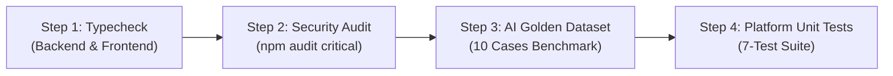

# Campus Facility Maintenance Platform (Team 10)

[](https://github.com/Justcode055/Maintenance_Team10_Test/actions/workflows/ci.yml)


A contract-first campus maintenance platform that turns repair reports into trackable work orders with role-based dispatching, AI-assisted facility categorization with prompt injection defense, audit history, and event-driven webhooks.

Built for **Mae Fah Luang University (MFU)** — **Course 1305308 Platform Development** (Gate 3 & Lab 1 / Lab 2).

---

## 📌 Quick Access & Team Project Board

- **Interactive Team Project Board:** Open [`TEAM_PROJECT_BOARD.html`](./TEAM_PROJECT_BOARD.html) in your browser for task breakdown, copyable terminal commands, branch topology, and oral exam Q&A cheat sheets.
- **Main Team Repository:** [khantnyi673150/Maintenance_Team10](https://github.com/khantnyi673150/Maintenance_Team10)
- **Tested Reference Fork:** [Justcode055/Maintenance_Team10_Test](https://github.com/Justcode055/Maintenance_Team10_Test)

---

## Core Capabilities

- **Work-Order Lifecycle:** Create, list, view, update, and archive tickets through an atomic 5-stage lifecycle:  
  `OPEN` ➔ `ASSIGNED` ➔ `IN_PROGRESS` ➔ `RESOLVED` ➔ `CLOSED`.
- **Role-Based Access Control (RBAC):** Server-side enforcement ensuring students (`reporter`) cannot resolve or close tickets; resolution requires the `staff` role (`HTTP 403 Forbidden` on unauthorized attempts).
- **AI Facility Categorization with Security Defense (Lab 1 / Threat T-01):**  
  AI classifies problem descriptions into campus facility disciplines (Plumbing, Electrical, HVAC, Safety). Untrusted user input is encapsulated in XML tags and scanned with pre-execution regex interceptors (`[SYSTEM INSTRUCTION OVERRIDE]`, etc.). If an attack is detected, the AI safely triggers `fallbackToManual: true` in `< 0.1ms`.
- **Automated CI Quality Gates & Testing (Lab 2):**  
  GitHub Actions workflow running 4 automated gates (TypeScript typecheck, critical security audit, 10-Item Golden Dataset evaluation, and the 7-Test platform unit suite).
- **Audit Trails & Integrity:** Chronological, immutable history tracking and deterministic HMAC-SHA256 signed webhook dispatching (`maintenance.status_changed`) to partner services (Team 12).

---

## Architecture

```text
┌─────────────────────────┐       HTTPS       ┌──────────────────────────────┐
│ Next.js Frontend (3001) │ ────────────────▶ │ Next.js Backend API (3000)   │
│ • Ticket Tracker        │                   │ • REST Route Handlers        │
│ • Submit + AI Fallback  │                   │ • requireAuth Middleware     │
│ • Staff Dispatch Board  │                   │ • AI Classifier & Prompt Def.│
└─────────────────────────┘                   └──────────────┬───────────────┘
                                                             │
                              ┌──────────────────────────────┼──────────────────────────────┐
                              ▼                              ▼                              ▼
                     ┌────────────────┐             ┌────────────────┐             ┌─────────────────┐
                     │ Supabase Auth  │             │ PostgreSQL DB  │             │ Team 12 Partner │
                     │ JWT & Roles    │             │ Work Orders    │             │ Webhook (HMAC)  │
                     └────────────────┘             └────────────────┘             └─────────────────┘
```

See [`architecture.md`](./architecture.md) for the detailed component breakdown and failure-handling topology.

---

## Repository Structure

```text
Maintenance_Team10/
├── .github/workflows/
│   └── ci.yml                             # Automated 4-stage GitHub Actions CI Quality Gate
├── backend/
│   ├── app/api/ai/categorize/route.ts     # AI facility categorization endpoint
│   ├── app/api/work-orders/               # REST lifecycle route handlers
│   ├── lib/
│   │   ├── ai-classifier.ts               # AI model logic & prompt injection defense
│   │   ├── auth.ts                        # Server-side JWT & RBAC role checks
│   │   └── work-order-schemas.ts          # Zod request validation schemas
│   ├── supabase/migrations/               # Database schemas, RLS policies, and triggers
│   ├── tests/
│   │   ├── golden-dataset.test.ts         # 10-Item AI Golden Dataset Benchmark
│   │   ├── platform-suite.test.ts         # Minimum 7-Test Platform Suite (Slide 31)
│   │   └── unit-suite.test.ts             # Unit test runner
│   ├── package.json                       # Scripts for typecheck, dev, and tests
│   └── README.md                          # Backend-specific details
├── frontend/
│   ├── app/page.tsx                       # 3 Core user screens + manual dropdown fallback
│   ├── app/globals.css                    # Theme styling (preset b7Br9WuC8: Maia/Mist/Red)
│   ├── tailwind.config.js                 # Tailwind palette & geometry
│   └── README.md                          # Frontend setup
├── diagrams/                              # Architecture diagrams & decision models
├── TEAM_PROJECT_BOARD.html                # Visual task board & teammate instruction guide
├── Lab1-Security.md                       # Threat modeling, attack payloads & code defense
├── Lab2-Quality-Gates-and-Testing.md      # CI quality gate report & Red-to-Green evidence
├── A3-Team10-Database-Design.md           # Database design & schema specification
├── A5-Team10-Integration-Evidence.md      # Inter-service integration & webhook proofs
└── PRD_Maintenance.md                     # Product requirements document
```

---

## Prerequisites

- **Node.js 22 LTS or later** *(Required for native TypeScript `--experimental-strip-types` support in the test runner)*
- **npm** (v10+)
- A **Supabase** project with PostgreSQL and Authentication enabled

---

## Local Setup

### 1. Configure the Backend

```powershell
cd backend
npm install
Copy-Item .env.example .env.local
```

Set required variables in `backend/.env.local`:

```dotenv
NEXT_PUBLIC_SUPABASE_URL=https://<project-ref>.supabase.co
NEXT_PUBLIC_SUPABASE_ANON_KEY=<supabase-anon-or-publishable-key>
FRONTEND_ORIGINS=http://localhost:3001
SUPABASE_SERVICE_ROLE_KEY=<server-only-secret-key>
```

### 2. Apply Database Migrations

Apply migration files in `backend/supabase/migrations` sequentially in numeric order using Supabase SQL Editor:
1. `001_initial_schema.sql`
2. `002_api_policies_and_lifecycle.sql`
3. `003_atomic_create_and_start.sql`
4. `004_seed_api_test_data.sql`
5. `005_fix_api_test_uuid_values.sql`
6. `006_partner_webhook_events.sql`

### 3. Configure the Frontend

```powershell
cd ..\frontend
npm install
Copy-Item .env.example .env.local
```

Set variables in `frontend/.env.local`:

```dotenv
NEXT_PUBLIC_API_BASE_URL=http://localhost:3000/api
NEXT_PUBLIC_SUPABASE_URL=https://<project-ref>.supabase.co
NEXT_PUBLIC_SUPABASE_ANON_KEY=<supabase-anon-or-publishable-key>
```

### 4. Start Development Servers

**Backend (Port 3000):**
```powershell
cd backend
npm run dev
```

**Frontend (Port 3001):**
```powershell
cd frontend
npm run dev
```

Check health: `http://localhost:3000/api/health`

---

## API Routes

| Method | Route | Access | Purpose |
|---|---|---|---|
| `POST` | `/api/ai/categorize` | Public/Auth | Categorize issue descriptions via AI with injection defense |
| `POST` | `/api/work-orders` | Reporter / Staff | Create a new work order (`OPEN`) |
| `GET` | `/api/work-orders` | Reporter / Staff | List work orders with status and category filters |
| `GET` | `/api/work-orders/{id}` | Reporter / Staff | Retrieve details of a specific work order |
| `PATCH` | `/api/work-orders/{id}` | Staff | Update work-order metadata |
| `DELETE` | `/api/work-orders/{id}` | Staff | Soft-archive a work order (`archived_at`) |
| `POST` | `/api/work-orders/{id}/assign` | Staff | Assign ticket to a maintenance technician |
| `POST` | `/api/work-orders/{id}/in-progress` | Staff | Move assigned ticket to `IN_PROGRESS` |
| `POST` | `/api/work-orders/{id}/resolve` | **Staff Only** | Resolve order with resolution notes (`403` for reporters) |
| `POST` | `/api/work-orders/{id}/close` | **Staff Only** | Formally close a resolved order |
| `GET` | `/api/work-orders/{id}/history` | Reporter / Staff | View chronological, immutable audit history |

Protected endpoints require a Supabase Bearer token:
```http
Authorization: Bearer <supabase-access-token>
```

---

## 🧪 Automated Testing & Quality Gates

Run automated validation suites from the repository:

### 1. TypeScript Compile Verification
```powershell
npm run typecheck --prefix backend
npm run typecheck --prefix frontend
```

### 2. Minimum 7-Test Platform Suite (Slide 31)
Runs unit, integration, authentication/authorization, and end-to-end tests:
```powershell
npm run test:unit --prefix backend
```
*Tests lifecycle valid transitions, deterministic HMAC-SHA256 webhook generation, work order creation, audit history, HTTP 403 RBAC rejection, full 5-stage E2E flow, and AI classification behavior.*

### 3. 10-Item AI Golden Dataset Benchmark (Slide 37)
Evaluates AI categorization across 5 quality dimensions (Correctness, Safety, Enum Grounding, Schema Validity, Latency SLA <1500ms):
```powershell
npm run test:ai-eval --prefix backend
```

---

## 🛡️ GitHub Actions CI Quality Gate ("Hunt a Real Bug")

Continuous Integration runs on all pushes and Pull Requests via [`.github/workflows/ci.yml`](./.github/workflows/ci.yml):



### Red ➔ Green Proof Lifecycle:
- **Red Failure (Run `#40834684579`):** Pipeline failed under Node 20 because native TypeScript type-stripping (`--experimental-strip-types`) requires Node 22+. The quality gate blocked deployment as intended.
- **Green Pass (Run `#40835134700` / `#41035517408`):** Workflow updated to Node 22 LTS; all 4 quality gates pass in **38 seconds**.

---

## 📚 Documentation Index

- [Interactive Team Board (`TEAM_PROJECT_BOARD.html`)](./TEAM_PROJECT_BOARD.html)
- [Lab 1 Security Dossier (`Lab1-Security.md`)](./Lab1-Security.md)
- [Lab 2 Quality Gates & Testing Report (`Lab2-Quality-Gates-and-Testing.md`)](./Lab2-Quality-Gates-and-Testing.md)
- [Assignment 3: Database Design (`A3-Team10-Database-Design.md`)](./A3-Team10-Database-Design.md)
- [Assignment 5: Integration Evidence (`A5-Team10-Integration-Evidence.md`)](./A5-Team10-Integration-Evidence.md)
- [Product Requirements Document (`PRD_Maintenance.md`)](./PRD_Maintenance.md)
- [Platform Architecture (`architecture.md`)](./architecture.md)

---

## Security Best Practices

- Never commit passwords, Supabase service-role keys, webhook secrets, partner API keys, or access tokens.
- Use `.env.example` templates and keep production secrets in environment variables or deployment secret stores.
